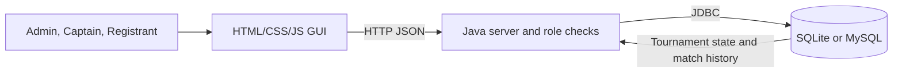

# MIT League — Esports Tournament Management

[](https://www.oracle.com/java/) [](https://docs.oracle.com/javase/8/docs/technotes/guides/jdbc/) [](#database) [](https://mit-league.vercel.app)

A college esports tournament manager for team registration, match scheduling, score reporting, and live standings. It includes a responsive web GUI and Java HTTP server with JDBC persistence for local coursework demonstrations.

> **Vercel note:** The live site is a browser-only demo using browser storage. Run Java locally for SQLite/MySQL persistence and server-side role checks.

## Screenshots

Demo data is fictional.

| Role selection | Registration and teams |
| --- | --- |
|  |  |
| Admin schedule | Standings |
|  |  |

## Problem statement

College esports events often coordinate team details, fixtures, and results through separate spreadsheets or messages. MIT League brings these tasks together, applies role-specific access, and connects results and standings to a database in local mode.

## Highlights

- Register teams with game, college/club, captain, roster size, and optional player names.
- Schedule matches between teams playing the same game; report scores and calculate standings.
- Admins can change scores, cancel matches, and export standings as CSV. Match actions are recorded in history.
- Captains view schedules, results, and standings. Register users submit teams and view registered team names only.

## Software requirements (SRS)

**Functional:** Admin, Captain, and Register roles; team registration; match scheduling; score updates; cancellations; standings and CSV export.

**Non-functional:** responsive GUI; same-origin JSON API in local mode; server-side role validation; relational database with transactional updates.

## Tools and concepts

| GUI | Server | Database / build / hosting |
| --- | --- | --- |
| HTML, CSS, JavaScript | Java 17+, built-in HTTP server | JDBC, SQLite or MySQL, Maven; Vercel static demo |

## Roles

| Role | Permissions |
| --- | --- |
| Admin | Register teams, schedule matches, update scores, cancel matches, export standings, reset demo data. |
| Captain / Team | View schedule, scores, results, and standings. |
| Register | Submit registration and view registered team names only. |

Local Java mode enforces roles. Vercel role selection is only a client-side demo and is not secure authentication.

## DFD and use-case diagrams

Public editable Draw.io file: [Open in diagrams.net](https://app.diagrams.net/?url=https%3A%2F%2Fraw.githubusercontent.com%2FJaiakash1508%2FEsports-Tournament-Management-V2%2Fmain%2Fdocs%2Fmit-league-diagrams.drawio) · [View source](docs/mit-league-diagrams.drawio).



Use cases: Admin registers teams, schedules/cancels matches, reports scores, and exports standings; Captains view schedules and results; Registrants submit teams.

## Database

The database stores tournaments, teams, players, matches, and match history. One tournament has many teams and matches; each team belongs to one tournament and can have multiple players. Matches reference two participating teams. The history table logs scheduling, score changes, and cancellations with timestamps. Foreign keys maintain relationships; match updates and history entries are saved in one transaction. The local GUI accesses data through the Java server's `/api/state` endpoint.

| Table | Stores |
| --- | --- |
| `tournaments` | Tournament name, season, status. |
| `teams` | Team, game, college/club, roster size. |
| `players` | Captain and roster linked to a team. |
| `matches` | Participants, scores, result status. |
| `match_history` | Timestamped scheduling, score, cancellation events. |

Schemas and fictional seed data: `src/main/resources/db/`. Generated databases are git-ignored; no database file needs submission.

## Run locally

Requirements: JDK 17+ and Maven 3.9+.

```text
Windows: run.bat
macOS/Linux: bash run.sh
```

Open http://localhost:8080. First run creates `data/mit-league.sqlite`. Demo accounts: `admin/admin123`, `captain/captain123`, `register/register123`. For MySQL, set `MIT_LEAGUE_DB_URL`, `MIT_LEAGUE_DB_USER`, and `MIT_LEAGUE_DB_PASSWORD` before launch. Do not commit real credentials.

## Repository layout

```text
index.html, styles.css, app.js       Web GUI
docs/                                Draw.io diagrams
screenshots/                         README screenshots
src/main/java/                       Java server
src/main/resources/db/               SQLite/MySQL schemas and seed
pom.xml, run.bat, run.sh              Build and launch
```

## Links

- **Live demo:** [mit-league.vercel.app](https://mit-league.vercel.app)
- **GitHub:** [prethvi0017/Esports-Tournament-Management-V2](https://github.com/prethvi0017/Esports-Tournament-Management-V2)
- **Draw.io:** [docs/mit-league-diagrams.drawio](docs/mit-league-diagrams.drawio)

Vercel hosts the static frontend only; the Java server and database run locally.
